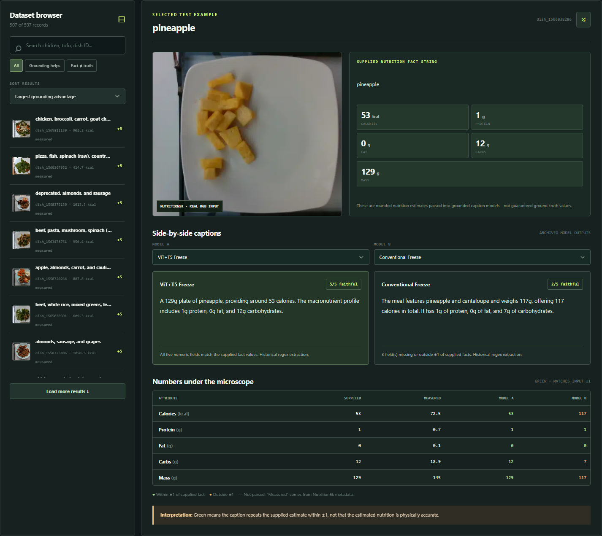

# Fact-Grounded Food & Nutrition Image Captioning

Food captions can sound convincing while inventing nutritional numbers. This project combines image-based nutrition estimation with neural caption generation to study whether descriptions preserve the facts they receive.

**Fanza Khairan Pratama** · Python · PyTorch · timm · Hugging Face Transformers

## What I built

- A five-output **EfficientNetV2-B0 regressor** estimating calories, protein, fat, carbohydrates, and mass from food images.
- A captioner combining **ViT image features, structured nutrition facts, and T5**, adapting pretrained backbones rather than designing them from scratch.
- A comparison of six methods on **507 test dishes**, including template filling, T5-only, and grounded versus image-only ViT/T5 variants with frozen or trainable ViT encoders.

## Key results

| Method | NutAcc | BLEU-4 | CIDEr |
|---|---:|---:|---:|
| Template Fill | 100.00% | 0.6515 | 4.7017 |
| Fact-grounded ViT + T5 Freeze | **96.37%** | 0.4062 | 2.3827 |
| Image-only ViT + T5 Freeze | 16.57% | 0.1060 | 0.4636 |

Grounding improves numerical faithfulness by **79.80 percentage points** over the frozen image-only baseline. **NutAcc measures agreement with CNN-provided facts within ±1; it is not ground-truth nutrition prediction accuracy.**

Template Fill achieves higher BLEU/CIDEr because it shares the template-based reference format. The research explores neural caption generation; it does not claim that the neural model beats templates. Ingredient names come from metadata, and competitive T5-only results limit claims about the visual contribution.

## Interactive demo



Explore **507 photos and 3,042 archived captions** with ingredient/dish search, synchronized filters and gallery, model comparison, and supplied-versus-measured nutrients. The demo displays stored outputs; it does not run live inference.

```bash
python -m http.server 8000 --directory docs
```

Open **http://localhost:8000/**. No hosted demo is claimed.

## Validation status

The [checkpoint evidence](validation/README.md) records an earlier review: **507/507 Freeze captions reproduced** with historical facts, matching BLEU-4/CIDEr/NutAcc. Separate CNN inference yielded calorie MAE **55.67 versus 53.59 kcal** historically; eight samples tested integration with fresh CNN facts. Historical CSVs remain unchanged. This finalization checks saved evidence, repository integrity, and demo behavior; checkpoint inference was not rerun.

## Implementation and checks

| Location | Purpose |
|---|---|
| [Main notebook](notebooks/food_nutrition_captioning.ipynb) | Pipeline, baselines, evaluation, and examples; training disabled by default |
| [Helper](research_utils.py), [requirements](requirements.txt) | Parsing/evaluation utilities and optional notebook environment |
| [results/](results/) | Historical evaluation tables and demo screenshot |
| [validation/](validation/) | Compact evidence and verification commands |
| [docs/](docs/), [tests/](tests/) | Static demo and automated regression checks |

Run `python -B validation/verify.py`, `python -B -m unittest discover -s tests -v`, and `node --test tests/test_explorer.cjs`. Lightweight CI runs these checks without model downloads.

## Data and licensing

Photos and measured metadata are from [Nutrition5k, Thames et al. (CVPR 2021)](https://github.com/google-research-datasets/Nutrition5k), licensed [CC BY 4.0](https://creativecommons.org/licenses/by/4.0/). Photos were converted to WebP; dish IDs are retained. No dataset-author endorsement is implied. Pretrained components retain their own terms. **MIT remains pending confirmation of code redistribution rights; no code license is granted.**
